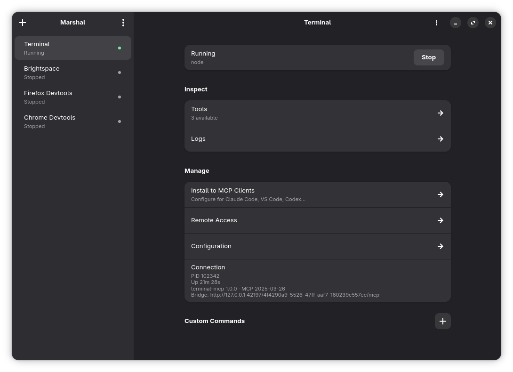

<div align="center">


# Marshal

Marshal is a program for the GNOME desktop. Marshal controls servers that use the Model Context Protocol (MCP).

</div>



## Function

Marshal can do these tasks:

- Start and stop MCP servers.
- Show the tools and the logs of a server.
- Install the server configuration in client programs.
- Give remote access with OpenAI, ngrok, Cloudflare Tunnel, or Tailscale Funnel.

## Start Marshal

The computer must have GTK 4.16 or a subsequent version, and libadwaita 1.7 or a subsequent version.

```sh
cargo run
```

## Stable remote connection paths

All remote providers use the saved server ID for the MCP path (`/<server-id>/mcp`), so restarting a tunnel, server, or Marshal keeps that path unchanged. Existing remote connections need their URL updated once after upgrading from a version that generated a fresh UUID for each tunnel start. Deleting and recreating a server gives it a new ID.

The public hostname is controlled by the tunnel provider. For ngrok, set **Public Domain (Optional)** in the provider settings to the assigned development domain or a domain configured in your ngrok account. Cloudflare Named Tunnel uses its configured hostname. Cloudflare Quick Tunnel still assigns a new hostname on each start.

## Cloudflare remote access

Install [`cloudflared`](https://developers.cloudflare.com/cloudflare-one/networks/connectors/cloudflare-tunnel/downloads/) on the host and make it available on `PATH`. The same requirement applies to Flatpak installations: Marshal starts the host's tunnel client, rather than installing one inside the sandbox.

Start an MCP server, open its **Remote Access** page, and choose one of the Cloudflare providers. **Enable Remote Access** starts the tunnel, and **Copy Connection** copies the complete MCP endpoint, including its bridge path. **Start with Server** can start the selected provider automatically on subsequent server starts.

### Quick Tunnel

Choose **Cloudflare Quick Tunnel** for temporary access without a Cloudflare account or credentials. Marshal forwards a loopback-only bridge through `cloudflared` and discovers the assigned hostname from the current client's local metrics API. Stopping remote access stops the tunnel process.

Quick Tunnels generate a new `trycloudflare.com` hostname on each start and do not support Server-Sent Events (SSE); MCP clients or tools that require SSE should use a named tunnel instead. Anyone with the complete endpoint can invoke the server's tools, so treat the URL as sensitive and do not use Quick Tunnels for persistent or sensitive access. See [Cloudflare's Quick Tunnel limitations](https://developers.cloudflare.com/tunnel/get-started/quick-tunnels/).

### Named Tunnel

Choose **Cloudflare Named Tunnel** for a remotely managed tunnel with a stable public hostname.

1. Create a remotely managed tunnel in the Cloudflare dashboard. Obtain its **tunnel token**, not a general Cloudflare API token, using [Cloudflare's tunnel token instructions](https://developers.cloudflare.com/tunnel/reference/tunnel-tokens/).
2. With the MCP server running, select **Cloudflare Named Tunnel** in Marshal. Enter the token and your public hostname, such as `mcp.example.com`, and save. Tokens are stored in the desktop keyring, not in the server configuration or exported JSON.
3. In Cloudflare, configure that public hostname to forward to the exact **Cloudflare HTTP Service** origin shown in Marshal's provider settings, for example `http://127.0.0.1:43210`. Leave the ingress path unrestricted so the full MCP bridge route is forwarded unchanged.
4. Configure a Cloudflare Access policy before enabling remote access. For non-interactive MCP clients, use a **Service Auth** policy that accepts an Access service token, and configure the client to send `CF-Access-Client-Id` and `CF-Access-Client-Secret` on its requests. See [Access service-token authentication](https://developers.cloudflare.com/cloudflare-one/access-controls/service-credentials/service-tokens/); an interactive browser login alone is not suitable for non-interactive MCP clients.
5. Enable remote access and copy the full connection URL, for example `https://mcp.example.com/<server-id>/mcp`. Add the Access credentials separately in the client if your policy requires them.

Named tunnels reuse the server's persistent local bridge port and path, rather than creating a new random origin for each tunnel start. If another process occupies the saved port, Marshal may select a different local port; update the Cloudflare HTTP service to match the current origin in provider settings. The **Connected** state indicates that `cloudflared` is connected to Cloudflare, not that your DNS, ingress, or Access policy has been verified end to end.

The token is supplied through `TUNNEL_TOKEN` and redacted from tunnel logs. Keep the token private because anyone who has it can run your tunnel, as described in [Cloudflare's token security guidance](https://developers.cloudflare.com/tunnel/reference/tunnel-tokens/). Without an Access policy, anyone with the public endpoint can use the MCP server's tools.

If startup fails, check the server's logs, verify that `cloudflared` is installed on the host, and confirm that the desktop keyring is available. If the tunnel connects but the MCP client cannot reach the server, check the Cloudflare hostname, its HTTP service origin, the full bridge path, and the client's Access credentials.

## Flatpak

Marshal can be built and installed as a Flatpak from this repository. The sandbox starts MCP servers, tunnel clients, and agent CLIs on the host, and it reads client configuration files in the home directory.

```sh
flatpak install --user flathub org.gnome.Platform//50 org.gnome.Sdk//50 \
  org.freedesktop.Sdk.Extension.rust-stable//25.08
./flatpak/update-cargo-sources.sh
flatpak-builder --user --install --force-clean builddir \
  flatpak/io.github._6E6B.marshal.yml
flatpak run io.github._6E6B.marshal
```

If a native Marshal process is already running, GTK will activate that window instead of opening a second copy. Quit the native build first when you want to test the Flatpak.

## License

GNU General Public License, version 3.0 or a subsequent version. See [LICENSE](LICENSE).
