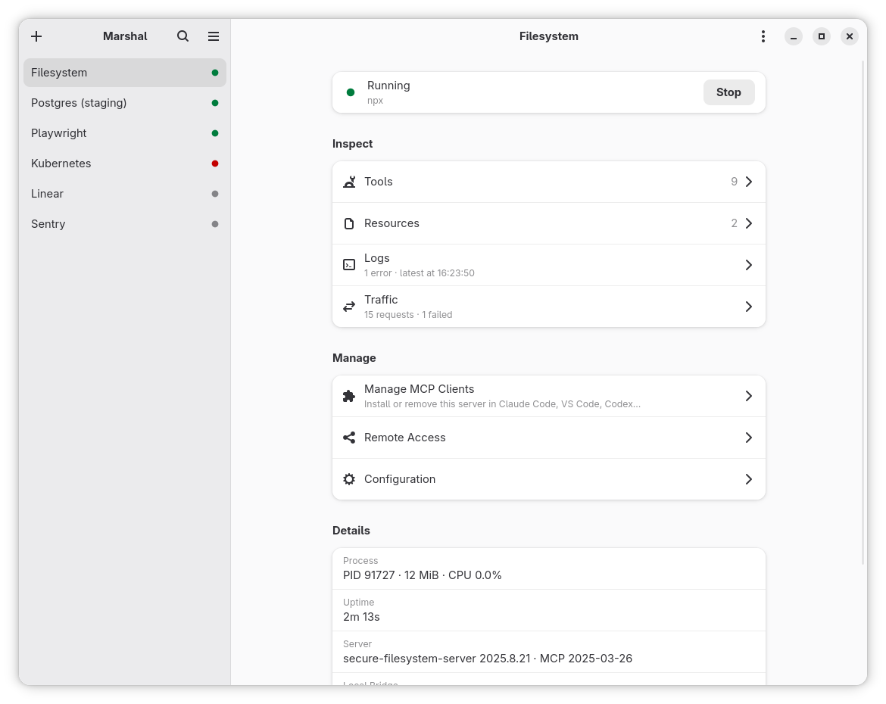
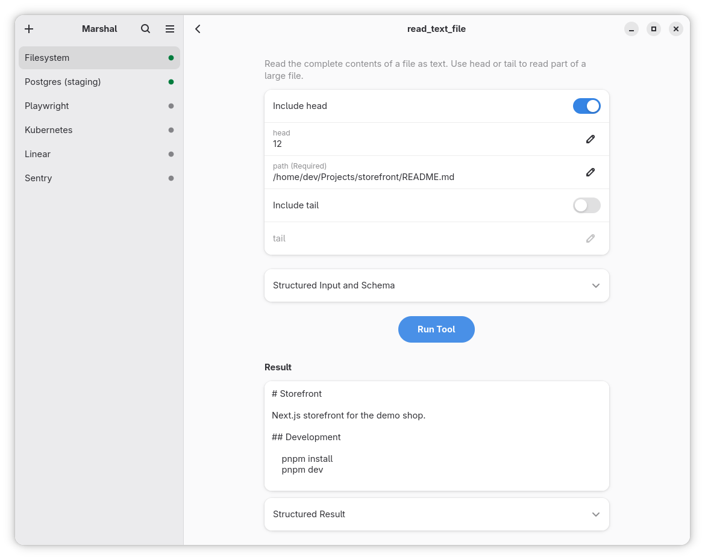
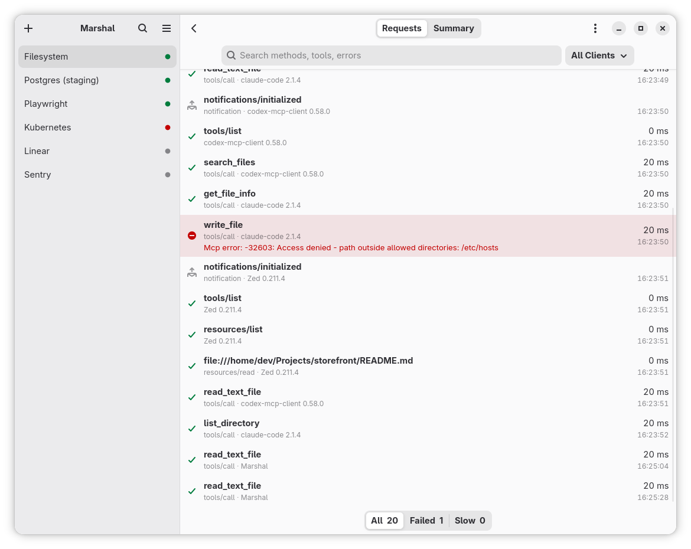
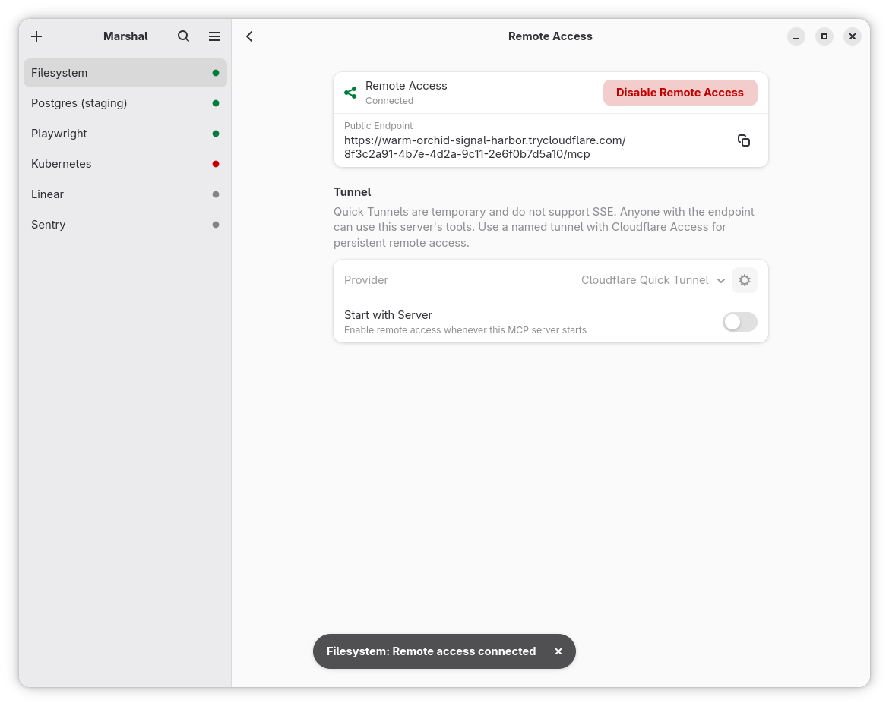

<div align="center">


# Marshal

An MCP server manager for GNOME.

</div>

Most coding agents (Claude Code, Codex, Cursor, Zed, etc.) start their own copy of each MCP server. Marshal runs each server once and lets all of your agents connect to it. It also gives you one place to start and stop servers, call their tools, read their logs and see which agent sent each request.



## Features

### Servers

Add local (command) or remote (HTTP) MCP servers, start and stop them, and group them into profiles that start together. You can search the MCP registry for servers to add. Secrets such as API keys are stored in the system keyring.

### Tools

Marshal lists the tools each server provides. You can call a tool with your own inputs without going through an agent.



### Traffic and logs

The Traffic view lists each request with the agent that sent it and how long it took. The Logs view shows the server's output.



### Agent configuration

Marshal detects which agents are installed and can add a server to an agent's config file. Other entries in the file are left as they are. It can also import servers from an agent's existing config.

Supported agents: Claude Code, OpenAI Codex, Cursor, VS Code, Zed, Windsurf, GitHub Copilot CLI, Google Antigravity, OpenCode, Amp, Devin, Kiro, Cline, Roo Code, Continue, Goose and Pi.

### Remote access

A server can be exposed over the internet through Cloudflare, ngrok, Tailscale Funnel or the OpenAI tunnel. This lets a web-based agent or another machine use a server running on your computer.



### Background operation

Marshal can run in the system tray, start at login and keep servers running in the background.

### Command line

```sh
marshal list              # List servers and their status
marshal start <server>    # Start a server
marshal stop <server>     # Stop a server
marshal restart <server>  # Restart a server
marshal profile <name>    # Start the servers in a profile
```

## Install

Download the Linux x86_64 `.flatpak` from [Releases](https://github.com/6E6B/marshal/releases/latest), then install it:

```sh
flatpak remote-add --user --if-not-exists flathub https://flathub.org/repo/flathub.flatpakrepo
flatpak install --user ./marshal-*-linux-x86_64.flatpak
flatpak run io.github._6E6B.marshal
```

Build and run from source:

```sh
cargo run --release
```

Or build the Flatpak:

```sh
flatpak-builder --user --install --force-clean builddir flatpak/io.github._6E6B.marshal.yml
flatpak run io.github._6E6B.marshal
```

For remote access, install the tunnel tool you want to use (`cloudflared`, `ngrok`, `tailscale`, etc.).

## Releases

Maintainers can build and publish from **Actions → Release → Run workflow**. See [the release guide](docs/releases.md) for version updates, draft review, and tag-based releases.

## License

GPL-3.0-or-later. See [LICENSE](LICENSE).
